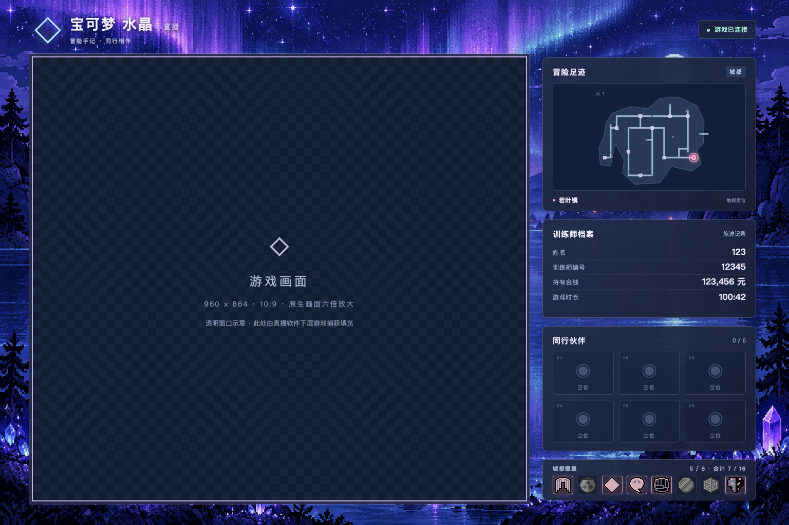
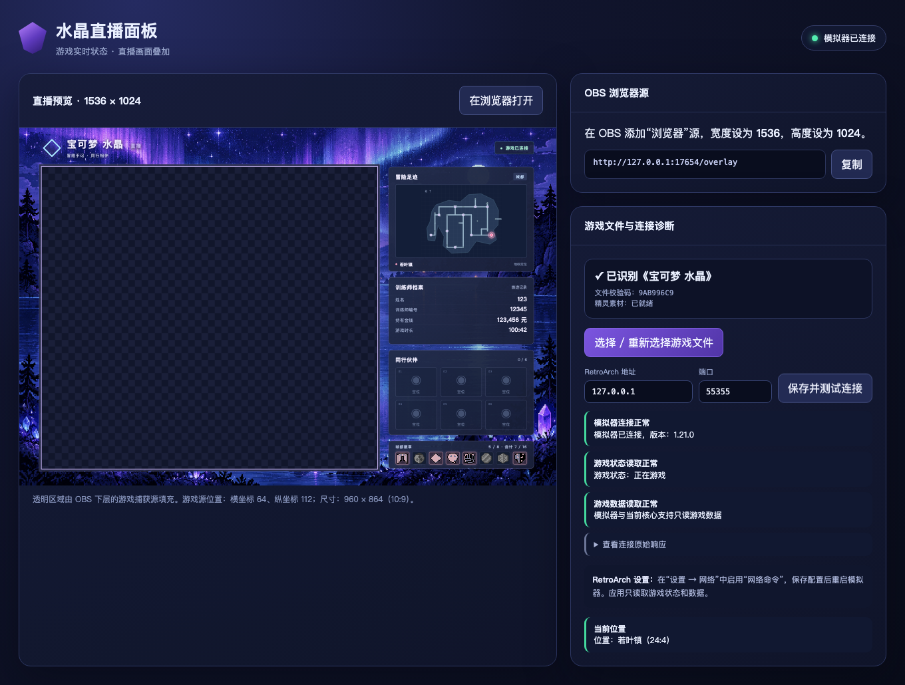

# Crystal Live Panel

**A live trainer, party, and adventure progress panel for Pokémon Crystal streams.**

[](https://github.com/itsVicOC/Crystal-Live-Panel/releases/latest)
[](https://github.com/itsVicOC/Crystal-Live-Panel/actions/workflows/build-windows.yml)
[](#compatibility)
[](LICENSE)

[简体中文](README.md) · **English**

[Download for Windows](https://github.com/itsVicOC/Crystal-Live-Panel/releases/latest) · [User guide](docs/USER_GUIDE.md) · [Report an issue](https://github.com/itsVicOC/Crystal-Live-Panel/issues) · [Changelog](CHANGELOG.md)

Crystal Live Panel is a Windows desktop companion that reads game state through RetroArch's local UDP network command interface. It displays trainer information, party sprites, and map position in an OBS browser source. OBS captures the game separately and combines it with the overlay through a transparent viewport.

> **Version note:** the latest published release is [v1.0.4](https://github.com/itsVicOC/Crystal-Live-Panel/releases/tag/v1.0.4). The screenshots below show a local, unreleased redesign. The Simplified Chinese interface, 16 badges across both regions, moving route markers, and new layout are under development and are not included in v1.0.4. This README update does not publish a new application release.

## Contents

- [Preview](#preview)
- [Features](#features)
- [Compatibility](#compatibility)
- [Quick start](#quick-start)
- [OBS setup](#obs-setup)
- [Frequently asked questions](#frequently-asked-questions)
- [Local data and privacy](#local-data-and-privacy)
- [Run from source](#run-from-source)
- [Architecture and interfaces](#architecture-and-interfaces)
- [Documentation](#documentation)
- [Contributing](#contributing)
- [Acknowledgments and license](#acknowledgments-and-license)

## Preview



*Development preview with sample data. The checkerboard and game-area label illustrate transparency; OBS fills this area with the game capture below the overlay. The empty party demonstrates the placeholder state. See the [preview notes](docs/images/README.md) for asset attribution.*

<details>
<summary>Show the development control panel</summary>



The control panel provides game file selection, local host and port settings, connection tests, diagnostics, and an overlay preview. The screenshot uses sample trainer data.

</details>

## Features

| Capability | Published v1.0.4 | Local development version (unreleased) |
| --- | --- | --- |
| Trainer | Name, five-digit ID, money, and play time | Retained in redesigned information cards |
| Party | Front sprites and levels for up to six Pokémon | Three columns × two rows, species numbers, and Chinese level labels |
| Badges | Eight Johto badges | Eight badges per region, automatic regional switching, and a combined total of 16 |
| Map | Johto landmarks; a `KANTO` label in Kanto | Separate regional maps, landmark mappings for 388 maps, and relative movement along 46 routes |
| Interface | Original layout and labels | Simplified Chinese UI, a purple night landscape, and separate sidebar cards |
| OBS | A `1536 × 1024` browser overlay | Same canvas, with an exact 6× native GBC game viewport |

Both versions attempt to poll at **4 Hz** and retain the last valid data when the game is paused, the connection drops, or validation fails. The only permitted commands are `VERSION`, `GET_STATUS`, and `READ_CORE_RAM`. The application does not modify the ROM, saves, or emulator memory.

Development maps are regional schematics: route markers show relative progress along a route, while towns, buildings, and caves use fixed landmarks. They are not tile maps or navigation tools. HP, status conditions, held items, and moves are not currently displayed. Other games, ROM revisions, and cores have no compatibility guarantee.

The English README documents the same application; it does not add an English UI. The unreleased redesign currently uses Simplified Chinese labels.

## Compatibility

RetroArch, Crystal Live Panel, and OBS must run on the **same computer**.

| Component | Requirement |
| --- | --- |
| Operating system | Windows 10 / 11, x64 |
| Emulator | RetroArch with Network Commands enabled |
| Core | `Nintendo - Game Boy / Color (TGB Dual)`, or `tgbdual-libretro`, in ordinary single-game mode |
| Game file | The specific Rev 1-based patched build with header title `PM_CRYSTAL`; both hashes below must match |
| Streaming software | OBS Studio with browser source support |
| RetroArch connection | UDP at `127.0.0.1:55355` by default; configurable port |
| Overlay server | HTTP / WebSocket at the fixed address `127.0.0.1:17654` |

```text
CRC32     9AB996C9
SHA-256   65701F63CFB8BCF88A56A6930236E659FC01FEC22BFAD0BE8BB49C739ADA406C
```

**A matching title or Rev 1 label alone does not establish compatibility.** Clean ROMs and other translations or patches can have different hashes, memory layouts, or graphics offsets. The application verifies the file locally; use the exact hashes as the reference.

Neither the repository nor release packages provide ROMs, saves, BIOS files, or Pokémon sprites extracted at runtime. Supply a game file you are entitled to use. macOS, Linux, other architectures, and dual-game mode are outside the current support scope.

## Quick start

1. **Download and launch.** Open [Releases](https://github.com/itsVicOC/Crystal-Live-Panel/releases/latest), download and fully extract `Crystal-Live-Panel-<version>-x64.zip`, then run `Crystal Live Panel.exe`. An `.exe` installer is also available. End users do not need Node.js.
2. **Enable RetroArch network commands.** Turn on `Settings → Network → Network Commands`, keep port `55355`, save the configuration, and fully restart RetroArch.
3. **Load the game.** Open the supported ROM with TGB Dual in ordinary single-game mode, then enter playable gameplay through a new game or a loaded save.
4. **Select the same ROM in the panel.** Click `选择 / 重新选择 ROM` (select/reselect ROM), labeled `选择 / 重新选择游戏文件` in the development version. Wait for local verification and sprite extraction.
5. **Test the connection.** Use `127.0.0.1` and the same UDP port, then click `保存并测试连接` (save and test connection). Expect `UDP_VERSION_OK`, `GET_STATUS_OK`, and `READ_CORE_RAM_OK`. Development diagnostics use Chinese titles; hover over a title to see its code.
6. **Set up OBS.** Add the browser source and align the game capture using the [settings below](#obs-setup). Keep the application running and verify the trainer and party in the preview before streaming.

Release binaries currently have no commercial code-signing certificate. If Windows flags an unknown publisher, check the download source and verify checksums when supplied in the Release. There is no automatic updater; close the old application and fully extract the new version when updating.

## OBS setup

Place the **Crystal Live Panel browser source above the RetroArch capture** in the OBS source list.

| Browser source option | Value |
| --- | --- |
| URL | `http://127.0.0.1:17654/overlay` |
| Width | `1536` |
| Height | `1024` |
| Custom CSS | Leave empty |

Crop the RetroArch capture to the game content, then apply the transform for your version. Coordinates are relative to the overlay's top-left corner and assume the browser source has not been scaled:

| Game capture setting | Original v1.0.4 layout | Unreleased layout shown above |
| --- | --- | --- |
| Position X / Y | `194` / `108` | `64` / `112` |
| Width × height | `854 × 768`, the old viewport bounds | `960 × 864`, exactly `10:9` |

The new viewport is six times the GBC's native `160 × 144` resolution. When using the redesign, update the capture transform and refresh the browser source. Do not apply the new coordinates to v1.0.4. For other streaming canvas sizes, group both sources and scale or move the group proportionally.

The overlay does not capture video or audio; configure those sources in OBS. See the [user guide](docs/USER_GUIDE.md) for detailed instructions in Chinese.

## Frequently asked questions

| Symptom | Check first |
| --- | --- |
| `UDP_NO_RESPONSE` or always offline | Enable and save Network Commands, restart RetroArch, and match both ports |
| Status works but RAM reads fail | Use a recent official RetroArch build and TGB Dual in single-game mode; a RetroAchievements login is not required |
| `UNSUPPORTED_ROM` / `ROM_CRC_MISMATCH` | Match both file hashes and select the same game in RetroArch and the panel |
| `RAM_ALL_ZERO` or no live data | Enter gameplay and check the core and field diagnostics; invalid frames never replace valid state |
| Party data appears but sprites are missing | Reselect the ROM to extract the cache and check write permissions for the user data directory |
| OBS cannot load the page or the capture is misaligned | Keep the application running, check port `17654`, and use the source dimensions and capture transform for your version |
| Data remains visible after pausing or disconnecting | Retaining the last valid state is intentional; check the connection indicator |
| Chinese player names are not recognized | The name decoder supports English letters, digits, and limited punctuation; Chinese UI labels do not add a Chinese name character table |

See [troubleshooting](docs/TROUBLESHOOTING.md) for more diagnostic codes. When reporting an issue, include the application, Windows, RetroArch, and core versions, the CRC32, diagnostic codes, and reproduction steps. Do not attach ROMs or saves; redact private information from screenshots.

## Local data and privacy

- The ROM is read locally for identity verification and sprite extraction. The original ROM is not copied, and game files and RAM are not uploaded.
- There is no telemetry, account system, or cloud service. HTTP / WebSocket binds only to `127.0.0.1`; UDP settings accept only `127.0.0.1` or `localhost`.
- A client command allowlist rejects memory writes. Only complete, validated state updates the panel.
- Player name, ID, and game progress are visible in the overlay and become public when included in a stream.

Windows user data is normally stored here:

```text
%APPDATA%\crystal-live-panel\
├── config.json            # Original ROM path, local host, and port
└── sprites\9AB996C9\       # PNG cache extracted from the local ROM
```

Updates normally retain this data. To remove the portable application, delete its program folder. To also remove settings and cached sprites, close the application and delete the user data directory above. You will need to select the ROM again on the next launch.

## Run from source

Use **Node.js 22 LTS and npm**. Packaging and streaming acceptance target Windows x64.

```bash
git clone https://github.com/itsVicOC/Crystal-Live-Panel.git
cd Crystal-Live-Panel
npm ci
npm test
npm start
```

`npm start` builds the project before launching Electron. To build without launching, run `npm run build`.

| Command | Purpose |
| --- | --- |
| `npm test` | Unit tests; optional real-ROM tests are skipped unless a ROM is supplied |
| `npm run test:watch` | Watch files and rerun tests |
| `npm run test:udp` | Socket integration tests with a temporary local UDP server |
| `npm run build` | Build the Vite pages and TypeScript main process |
| `npm run package:win` | Build the Windows x64 NSIS installer |
| `npm run package:win:zip` | Build the Windows x64 portable ZIP |
| `npm run package:win:all` | Build both NSIS and ZIP packages |

Packages are written to `release/`. Use a Windows x64 development machine or a GitHub Actions Windows runner for packaging. The workflow supports manual builds and builds and publishes releases on `v*` tag pushes; an ordinary documentation commit does not create a Release.

To run the optional tests against a real ROM, supply its local path explicitly:

```powershell
# Windows PowerShell
$env:CRYSTAL_TEST_ROM = "C:\Games\game.gbc"
npm test
Remove-Item Env:CRYSTAL_TEST_ROM
```

```bash
# Bash / Zsh
CRYSTAL_TEST_ROM="/absolute/path/to/game.gbc" npm test
```

Keep ROMs, saves, extracted sprites, and machine-specific paths out of the repository. Support for another ROM requires a separate Profile, exact hashes, and matching tests. See the [development guide](docs/DEVELOPMENT.md).

## Architecture and interfaces

```text
RetroArch + TGB Dual
  └─ Local UDP: VERSION / GET_STATUS / READ_CORE_RAM
      └─ Electron main process: read → decode and validate → retain last valid state
          └─ 127.0.0.1:17654: HTTP + WebSocket
              ├─ Electron control panel
              └─ OBS browser source
```

| Local interface | Purpose |
| --- | --- |
| `GET /control` | Control panel page; system actions such as ROM selection require the Electron bridge |
| `GET /overlay` | Fixed-size page for OBS |
| `GET /api/state` | Current JSON state snapshot |
| `ws://127.0.0.1:17654/ws` | Sends current state on connection, then pushes complete state updates |
| `GET /sprites/001.png` | Locally extracted sprite with a three-digit filename |

```text
src/main/       Electron, UDP client, ROM/RAM decoding, local server
src/renderer/   Control panel and stream overlay
src/shared/     State types and ROM Profile
public/         Static page assets
scripts/        Build helpers and asset processing
docs/           User, development, and architecture documentation
.github/        Windows build and release workflow
```

Read the [architecture guide](docs/ARCHITECTURE.md) for addressing modes, byte order, field validation, and security boundaries.

## Documentation

The detailed guides below are currently written primarily in Chinese. This English README provides the setup, compatibility, troubleshooting, and development essentials.

| Document | Contents |
| --- | --- |
| [User guide](docs/USER_GUIDE.md) | Installation, streaming, OBS alignment, daily use, and removal |
| [Troubleshooting](docs/TROUBLESHOOTING.md) | Diagnostic codes, connection, game file, RAM, and display issues |
| [Development guide](docs/DEVELOPMENT.md) | Environment, testing, builds, Profiles, and releases |
| [Architecture](docs/ARCHITECTURE.md) | Processes, data flow, interfaces, and security design |
| [Contributing](CONTRIBUTING.md) | Issues, pull requests, and contribution requirements |
| [Security policy](SECURITY.md) | Supported versions and private vulnerability reporting |
| [Changelog](CHANGELOG.md) | Published changes; local development changes may not yet be pushed |
| [Third-party notice](NOTICE.md) | Third-party game assets, trademarks, and licensing scope |

## Contributing

Reproducible bug reports, documentation improvements, and feature suggestions are welcome through [Issues](https://github.com/itsVicOC/Crystal-Live-Panel/issues), as are pull requests. Read the [contribution guide](CONTRIBUTING.md), branch from the latest `main`, add tests for behavior changes, and run `npm test` and `npm run build` before submitting.

Preserve the local-only connections, read-only commands, and absence of telemetry. Report security issues privately following the [security policy](SECURITY.md); keep exploit details and private files out of public issues.

## Acknowledgments and license

Thanks to the [RetroArch / Libretro](https://github.com/libretro/RetroArch), [TGB Dual](https://github.com/libretro/tgbdual-libretro), [OBS Studio](https://github.com/obsproject/obs-studio), [Electron](https://github.com/electron/electron), [pret/pokecrystal](https://github.com/pret/pokecrystal), and [pret/pokered](https://github.com/pret/pokered) communities for their tools, research, and reference material.

Maintained by [itsVicOC](https://github.com/itsVicOC) and contributors. Original source code and original documentation are licensed under the [MIT License](LICENSE). MIT does not grant rights to third-party trademarks, characters, game data, or artwork. See [NOTICE.md](NOTICE.md) for the applicable scope.

Crystal Live Panel is an unofficial fan project and is not affiliated with, sponsored by, or endorsed by Nintendo, Creatures, GAME FREAK, The Pokémon Company, RetroArch, Libretro, or OBS Project.
