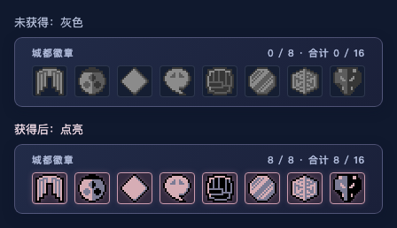
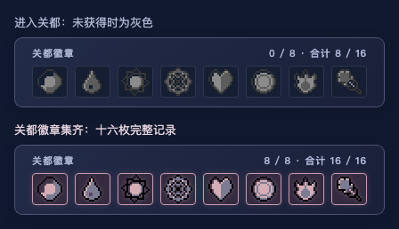
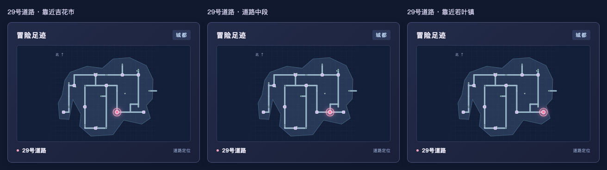

# 直播背景与布局

当前背景使用内置 image_gen 工具生成；源图位于 `assets/overlay-night-source.png`，运行时素材为 `public/overlay-background.png`。

画布为 1536×1024。游戏透明窗口为 X=64、Y=112、960×864，恰好是 Game Boy Color 160×144 的六倍。右侧卡片和顶部状态提示位于窗口之外。

`src/shared/overlay-layout.json` 是布局参数的唯一来源。背景处理脚本清除游戏窗口内全部像素；renderer 还使用相同参数绘制 SVG 遮罩，确保替换为不透明背景时仍保留透明窗口。地图、文字、队伍槽和徽章均独立渲染。徽章保留游戏原始像素造型，以灰色与获得后的游戏配色区分状态。

重新处理源图：

```bash
npm run prepare:background -- assets/overlay-night-source.png
```

## 布局预览与验证


预览使用示例训练师数据和空队伍；棋盘格与“游戏画面”文字仅用于说明透明区域，不出现在实际叠加层中。`images/overlay-transparent.png` 是实际透明渲染截图。直播界面的标题、区域、地名、徽章、等级和状态提示均以简体中文显示；玩家姓名保留游戏原文。

浏览器验证覆盖区域切换、城市与道路坐标、六个队伍槽及精灵缺失占位、徽章，以及在线、等待、暂停和断线状态。所有状态下游戏窗口内的 829,440 个像素均为透明。另以完全不透明的源图替换背景，确认运行时 SVG 遮罩同样能保留完整透明窗口。真实 RetroArch＋OBS 的画面合成仍需在目标直播环境中验收。

徽章显示对比：



浏览器中已核对八枚徽章的全部 1,525 个非透明原始像素，并逐一验证八个独立标志位只点亮对应徽章。

关都徽章及 16 枚合计进度：



关都采用初代训练师卡的原始徽章像素，统一使用现有灰色／水晶版点亮调色板。已核对全部 895 个非透明像素、八个独立标志位、城都／关都往返切换、乘船时保留最近徽章栏，以及 16 枚合计数量。

道路移动示意：



道路标记来自角色的实际地图内坐标，投影到区域示意图中共用的道路路径上。城镇、建筑及洞穴保持地标定位；区域图不表示完整的逐格地形。

## 生成提示词（原文）

```text
Use case: stylized-concept
Asset type: decorative background wallpaper for a Pokémon Crystal livestream overlay, landscape 1536 × 1024.
Primary request: a beautiful, restrained moonlit Johto-inspired crystal lake scene with lavender northern lights, midnight indigo sky, small distant Japanese pagoda silhouettes, luminous cyan reflections, sparse faceted violet crystals and dark forest silhouettes confined to the outside margins. Polished nostalgic pixel art with fine pixel texture, atmospheric and calm, matching the purple and blue aesthetic of Pokémon Crystal.
Composition/framing: the final UI places an actual transparent 960 × 864 game viewport at x=64, y=112, and four opaque information cards at x=1056, y=112 through y=976. These are reserved UI safe areas; keep them quiet and unobtrusive. Put the scenic highlights in the top horizontal margin and the narrow outside margins, with tiny crystal details along the bottom edge. Full canvas wallpaper only; the application will cut the exact game aperture and draw the UI itself.
Color palette: deep indigo, muted violet, icy cyan, soft lavender glints.
Constraints: no text, no lettering, no logos, no watermark, no map, no city map, no UI panels, no borders, no frames, no screens, no white rectangle, no characters or large foreground subjects, no bright objects in the center. Do not draw a mockup. Create the actual bitmap wallpaper. Landscape 3:2 composition.
```
